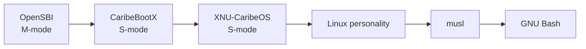

# XNU-CaribeOS RV32IMACSU

[](https://github.com/h0nda1337/caribeos-xnu-rv32/actions/workflows/static-checks.yml?query=branch%3Amain)
[](https://github.com/h0nda1337/caribeos-xnu-rv32/actions/workflows/documentation-checks.yml?query=branch%3Amain)

Experimental XNU-based RV32IMACSU operating system kernel with Sv32, SMP, a
Linux personality, real processes, and interactive GNU Bash.

CaribeOS is an independent experimental project. It is not affiliated with,
endorsed by, or supported by Apple Inc. It is not macOS, is not a complete
Darwin distribution, and is not production ready.

This repository is based on Apple's open-source XNU 2050.48.11 release and
contains the RV32 port used by CaribeOS. The companion
[CaribeOS runtime repository](https://github.com/h0nda1337/caribeos-runtime-rv32)
owns CaribeBootX, the HFS+ image builder, userland, QEMU runners, and semantic
gates.

The badges above report the public static and documentation checks. They do not
represent a full kernel build or the preserved long-form boot suites.

## Boot Contract

The supported boot chain is fixed:

```text
OpenSBI (M-mode) -> CaribeBootX (S-mode) -> XNU-CaribeOS (S-mode)
```



QEMU must use its OpenSBI firmware and pass CaribeBootX as the kernel:

```text
qemu-system-riscv32 -M virt -m 256 -bios default -kernel build/caribe_rv32.elf
```

CaribeBootX receives the DTB, initializes the minimum S-mode platform, reads an
HFS+ disk through virtio-blk, resolves `com.apple.Boot.plist` or the default
`/kernel.elf`, and transfers control to this kernel.

## Tranche 201

The preserved Tranche 201 build has the following verified surface:

| Status | Capability |
|---|---|
| Implemented | RV32IMACSU entry, Sv32, separate 2 GiB user/kernel halves, OpenSBI handoff, two-hart kernel SMP, per-hart state, IPI, timers, scheduler work, RFENCE TLB coherence |
| Implemented | Linux-personality ELF32 exec, task/thread-backed processes, fork/clone, wait/exit, per-process pmap and FDs, signal frames and `rt_sigreturn` |
| Implemented | Blocking TTY path, pipes, pipelines, tested job control, musl 1.2.5, interactive GNU Bash 5.3.5 |
| Experimental | Userspace execution on CPU1, scheduler migration, IOKit bootstrap/probes, HFS+ boot integration |
| Partial | Linux syscall surface, POSIX behavior, IOKit services, device model, VM hardening, error recovery |
| Not implemented | Production security, writable general-purpose filesystem, networking, broad hardware support, macOS ABI/application compatibility |

The project uses Linux-compatible interfaces as an experimental personality.
It does not embed or boot a Linux kernel.

## Build

On the verified Windows/MSYS2 toolchain:

```powershell
powershell -ExecutionPolicy Bypass -File .\tools\riscv32-link-full-stage0.ps1
```

The resulting kernel is:

```text
BUILD/obj/RELEASE_RISCV32/osfmk/RELEASE/xnu-caribeos-rv32-full-stage0.elf
```

For a complete boot image and tests, run the companion runtime's
`testproject.ps1`; see [BUILDING.md](BUILDING.md) and [TESTING.md](TESTING.md).

## Verify Tranche 201

The nonredundant validation set is:

```powershell
.\testproject.ps1 -Mode up -Seconds 45
.\testproject.ps1 -Mode gates -Seconds 50
.\testproject.ps1 -Mode interactive -Seconds 120
.\testproject.ps1 -Mode process-stability -Seconds 300
.\testproject.ps1 -Mode process-stress -Seconds 300 -StressRounds 10000
```

The final preserved ELF is 945,004 bytes with SHA-256:

```text
c63fe4bfbaeaf674a4092c1c579cfe472fc433d2e89b4f55307484ed820e595e
```

See [docs/TRANCHE_201_EVIDENCE.md](docs/TRANCHE_201_EVIDENCE.md) for the
evidence boundary and [RESTORE.md](RESTORE.md) for recovery.

## Project Documents

- [Architecture](ARCHITECTURE.md) and [port status](docs/PORT_STATUS.md)
- [Build](BUILDING.md), [testing](TESTING.md), and [restore](RESTORE.md)
- [Roadmap](ROADMAP.md), [support](SUPPORT.md), and [security](SECURITY.md)
- [Contributing](CONTRIBUTING.md) and [code of conduct](CODE_OF_CONDUCT.md)
- [License review](docs/PUBLIC_LICENSE_REVIEW.md) and [third parties](THIRD_PARTY.md)
- [Development with Codex](docs/DEVELOPMENT_WITH_CODEX.md) and [citation](CITATION.cff)

## Reporting Problems

Include the QEMU command, selected `testproject.ps1` mode, kernel SHA-256,
tool versions, complete serial log, CPU count, and whether the failure occurs
in UP, SMP, or both. Do not attach credentials, proprietary SDKs, or private
machine configuration.

## License

Original XNU files retain their existing notices and the Apple Public Source
License. CaribeOS additions do not replace or relicense upstream XNU. Review
[APPLE_LICENSE](APPLE_LICENSE), [NOTICE.md](NOTICE.md), and
[THIRD_PARTY.md](THIRD_PARTY.md) before redistribution. The technical public
license review is in [docs/PUBLIC_LICENSE_REVIEW.md](docs/PUBLIC_LICENSE_REVIEW.md).
